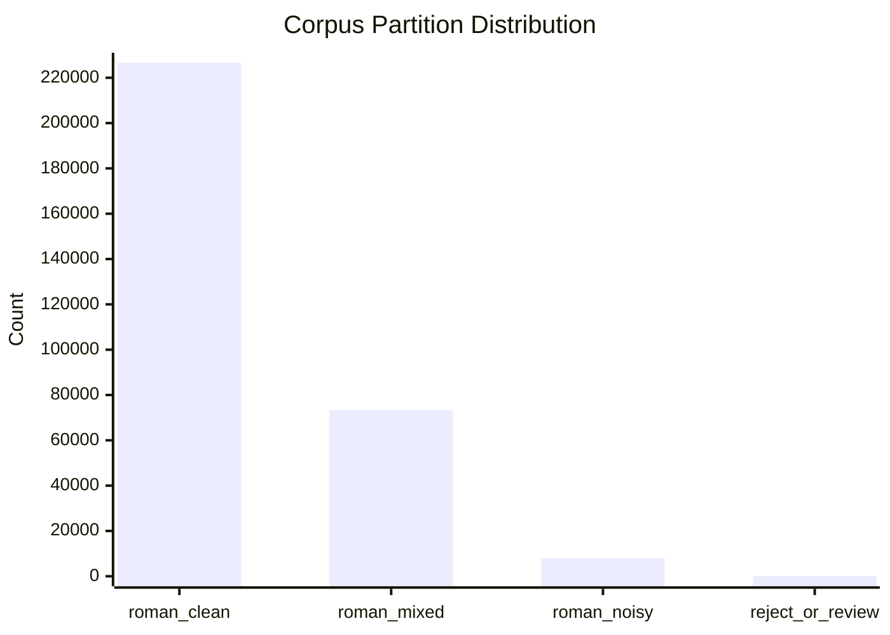

# External Corpus Quality Profile & Triage Report

- **Source File**: `/Users/purushottamghimire/romanized-nepali-nlp/data/raw/nepali_corpus_roman.parquet.jsonl`
- **Total Rows Ingested**: **307999**
- **Benchmark Overlap Quarantined**: **0**

## Quality Partitions Breakdown

| Partition | Count | Percentage | Description |
|---|---|---|---|
| `roman_clean` | **226612** | 73.6% | Likely target Romanized Nepali text |
| `roman_mixed` | **73345** | 23.8% | Code-switched with English vocabulary |
| `roman_noisy` | **7991** | 2.6% | Noisy formatting: repeated characters or emojis |
| `reject_or_review` | **51** | 0.0% | Non-Latin script, empty, or benchmark overlap |

