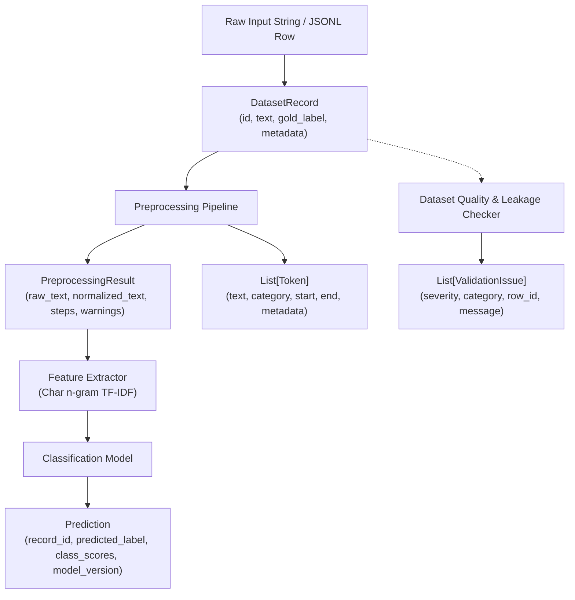

# API Contract & Schema Specification

This document defines the core data contracts, offset semantics, label vocabularies, and serialization schemas for the Romanized Nepali NLP toolkit.

## Offset Semantics

All character offsets (`start` and `end`) throughout the toolkit use **Python Unicode code-point positions** on the half-open interval `[start, end)`.
- Slicing `text[start:end]` in Python always recovers the exact original substring.
- Multibyte characters, accented Latin characters (e.g. `ā`, `ī`, `ū`), and Unicode emojis (e.g. `😊`, `🔥`) are counted by code points (`len(s)`), aligning directly with Python's built-in string index and `re.Match.span()` semantics.

---

## Data Flow Diagram



---

## Object Specifications & JSON Examples

### 1. `Token`

Represents a single lexical unit, punctuation mark, emoji, or protected pattern.

| Field | Type | Required | Description |
|---|---|---|---|
| `text` | string | Yes | The exact surface token slice from the input text |
| `category` | string enum | Yes | One of `WORD`, `ENGLISH_WORD`, `URL`, `EMAIL`, `MENTION`, `HASHTAG`, `NUMBER`, `EMOJI`, `PUNCTUATION`, `UNKNOWN` |
| `start` | integer | Yes | 0-based starting Unicode code-point index |
| `end` | integer | Yes | Exclusive ending Unicode code-point index (`text[start:end] == token.text`) |
| `normalized_text`| string | No | Optional canonical or lowercased form |
| `metadata` | object | No | Key-value dictionary for language flags, sentiment tags, etc. |

```json
{
  "text": "ramro",
  "category": "WORD",
  "start": 12,
  "end": 17,
  "normalized_text": "ramro",
  "metadata": {
    "variant_root": "ramro",
    "is_negated": false
  }
}
```

---

### 2. `PreprocessingResult`

Holds non-destructive normalization output while retaining full provenance and protected spans.

```json
{
  "raw_text": "Yo  camera  ekdam  RAAMRO  cha!! https://shop.com/item",
  "normalized_text": "yo camera ekdam raamro cha ! https://shop.com/item",
  "steps": [
    "unicode_nfc",
    "protect_urls",
    "normalize_whitespace",
    "collapse_punctuation"
  ],
  "warnings": [],
  "protected_spans": [
    {
      "start": 29,
      "end": 50,
      "category": "URL",
      "text": "https://shop.com/item"
    }
  ],
  "metadata": {
    "char_count_delta": -9
  }
}
```

---

### 3. `DatasetRecord`

Represents a record in a dataset split or evaluation slice.

```json
{
  "id": "nep_sent_0042",
  "text": "mitho khana tara service chai dherai dhilo thiyo",
  "label": "neutral",
  "source": "social_comments_anonymized",
  "split": "train",
  "metadata": {
    "domain": "restaurant_review",
    "verified_by": "curator_01"
  }
}
```

---

### 4. `ValidationIssue`

Reports schema violations, duplicates, or cross-split leakage.

```json
{
  "severity": "error",
  "message": "Duplicate text found across 'train' and 'test' splits with conflicting labels",
  "row_id": "nep_sent_0042",
  "field": "label",
  "category": "leakage"
}
```

---

### 5. `Prediction`

Standardized output from any sentiment classifier model.

```json
{
  "record_id": "nep_sent_0042",
  "predicted_label": "neutral",
  "class_scores": {
    "positive": 0.31,
    "neutral": 0.54,
    "negative": 0.15
  },
  "gold_label": "neutral",
  "model_version": "char_ngram_baseline_v0.1.0",
  "metadata": {
    "inference_latency_ms": 0.82
  }
}
```
