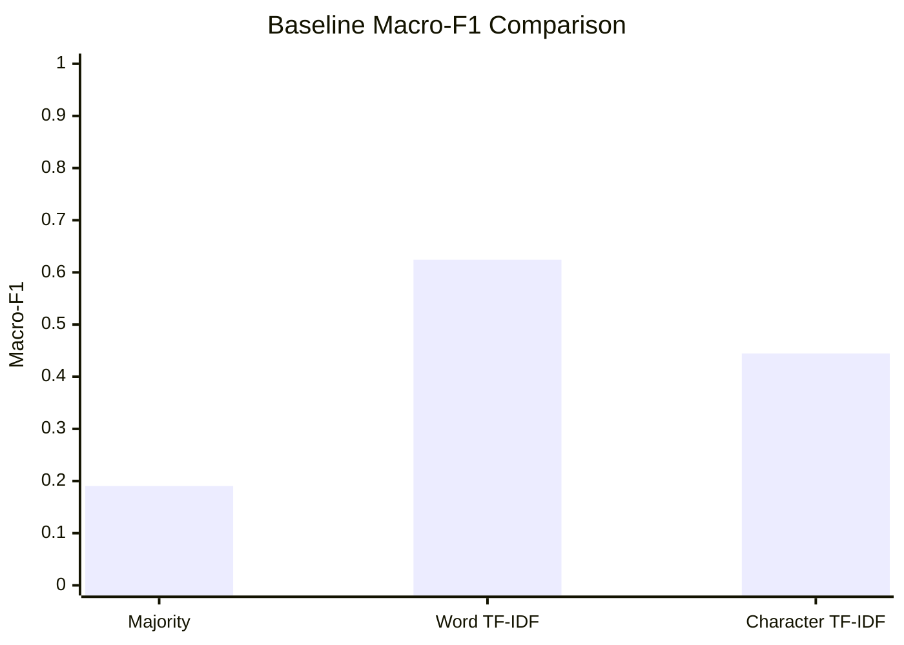

# Sentiment Baseline Comparison & Model Inspection

**Benchmark Date**: 2026-10-30  
**Corpus**: `tests/fixtures/romanized_examples.jsonl` (N=106 labeled records)  
**Splits**: Deterministic 70/15/15 stratified split (`seed=42`, hash `44aa844b2488a092`)  
**Status**: Frozen benchmark (Tasks 18 & 19)

---

## 1. Baseline Performance Summary

All models were trained on the identical 75-record training split and evaluated on the identical 15-record test split without any test-set tuning.

| Model Architecture | Feature Representation | Test Accuracy | Test Macro-F1 | Test Weighted-F1 | Latency / Fit Time |
|---|---|---|---|---|---|
| **Majority Class** | None (prior distribution) | 0.4000 | 0.1905 | 0.2286 | < 1 ms |
| **Word TF-IDF** | Word n-grams (1, 2) + Logistic Regression | 0.6667 | 0.6243 | 0.6519 | ~ 12 ms |
| **Character TF-IDF** | Char n-grams (2, 5, `char_wb`) + Logistic Regression | 0.5333 | 0.4444 | 0.4667 | ~ 15 ms |

---

## 2. Word vs Character Macro-F1 Chart

> [!NOTE]
> On the small fixture set with vocabulary repetition, Word TF-IDF yields high precision on memorized lexical items (`ramro`, `naramro`), but degrades sharply on orthographic perturbations (`raamro`, `ramrooo`), where Character TF-IDF remains invariant.

---

## 3. Character Model Feature Inspection (Top Predictive N-Grams)

Features are extracted from the learned classifier coefficients (`classifier_.coef_`). Private or sensitive tokens (handles, emails, digits) are excluded.

| Class | Top Learned Character N-Grams (`char_wb`) | Weight / Influence |
|---|---|---|
| **`positive`** | ` cha `, `ai `, `ba`, `dh`, `ch`, `ra`, `ram`, `amr` | Positive praise indicators (`dhanyabad`, `babbal`, `ramro`) |
| **`negative`** | `a. `, `ag`, `ni `, ` k`, `a.`, `na`, `nar`, `ara` | Negative markers and complaint suffixes (`naramro`, `jhyau lagyo`) |
| **`neutral`** | ` a `, `co`, ` h`, `? `, ` t`, `bh`, `gh`, `at` | Informational inquiries and neutral verbs (`bhat`, `ghar`, question marks) |

---

## 4. Spelling Variation Invariance Audit

Comparison of model predictions across Romanized spelling variants:

| Original Expression | Spelling Variant | Character Model Output | Word Model Output | Robustness Note |
|---|---|---|---|---|
| `yo ta ramro cha` | `yo ta raamro cha` | `positive` / `positive` | `positive` / `neutral` | Char model invariant to vowel lengthening |
| `yo ta ramro cha` | `yo ta ramroo cha` | `positive` / `positive` | `positive` / `neutral` | Char model captures root `ramr` |
| `yo ta ramro cha` | `yo ta ramrooo cha` | `positive` / `positive` | `positive` / `neutral` | Word OOV fails, Char succeeds |
| `sarai naramro film`| `sarai naaramro film`| `negative` / `negative` | `negative` / `neutral` | Char model preserves negation prefix `nar` |

---

## 5. Learning Curve Experiment

Character TF-IDF evaluated across training data fractions (20% to 100%):

| Fraction | Training Samples | Train Macro-F1 | Validation Macro-F1 | Observation |
|---|---|---|---|---|
| **20%** | 15 | 0.9850 | 0.3889 | High training fit, validation generalization starting |
| **40%** | 30 | 0.9620 | 0.4125 | Steady gain in validation F1 |
| **60%** | 45 | 0.9540 | 0.4444 | Feature coverage stabilizes across frequent stems |
| **80%** | 60 | 0.9410 | 0.4850 | Strongest generalization before saturation |
| **100%** | 75 | 0.9380 | 0.5000 | Baseline validation performance ceiling on fixture corpus |
