# Pilot Annotation Agreement Report & Disagreement Matrix

**Audit Date**: 2026-10-30  
**Guideline Version**: `v1.0.0-frozen`  
**Dataset**: Pilot sample (60 records) annotated independently by 2 annotators (`ann_1`, `ann_2`) with lead adjudication.

---

## 1. Summary Agreement Metrics

| Metric | Value | Interpretation |
|---|---|---|
| **Total Sample Size** | 60 | Pilot test slice covering ordinary and edge-case text |
| **Raw Observed Agreement ($P_o$)** | **63.33%** (38/60) | Moderate observed agreement prior to adjudication |
| **Chance Agreement ($P_e$)** | **33.33%** | Expected 3-class random agreement |
| **Cohen's Kappa ($\kappa$)** | **0.4500** | Moderate agreement before guideline clarification |

---

## 2. Disagreement Confusion Matrix

Annotator 1 labels on rows; Annotator 2 labels on columns:

| Annotator 1 \ Annotator 2 | `positive` | `negative` | `neutral` | Total Ann 1 |
|---|---|---|---|---|
| **`positive`** | **15** | 7 | 1 | 23 |
| **`negative`** | 5 | **12** | 0 | 17 |
| **`neutral`** | 4 | 5 | **11** | 20 |
| **Total Ann 2** | 24 | 24 | 12 | 60 |

---

## 3. Disagreement Categories & Inspection (22 Items)

| Category | Count | Primary Conflict | Adjudication Rule Applied |
|---|---|---|---|
| **Sarcasm / Irony** | 5 | Positive surface tokens vs negative intent | Intended negative sentiment wins; set confidence `< 0.8`. |
| **Mixed Sentiment (Concession)** | 5 | Positive clause vs negative clause (`tara` / `but`) | Recency rule: final concluding clause determines sentiment. |
| **Negation Nuances** | 4 | Double negations (`naramro chaina`) | Contextual polarity evaluated; litotes with neutral bias. |
| **Colloquial Slang** | 4 | Extreme words (`pagal`, `khatra`, `hawa`) | Distinguish positive slang (`khatra` = awesome) from insults. |
| **Code Switching & Questions** | 4 | English words and rhetorical questions | Code-switched words preserve sentiment; informational questions remain neutral. |

---

## 4. Label Distribution Before and After Adjudication

```mermaid
xychart-beta
    title "Label Distribution: Annotators vs Adjudicated Ground Truth"
    x-axis ["positive", "negative", "neutral"]
    y-axis "Sample Count" 0 --> 30
    bar [23, 17, 20]
    bar [24, 24, 12]
    bar [22, 23, 15]
```

*Legend: Bar 1 = Annotator 1, Bar 2 = Annotator 2, Bar 3 = Adjudicated (Frozen).*

### Distribution Table
| Split / Stage | `positive` | `negative` | `neutral` | Total |
|---|---|---|---|---|
| **Annotator 1** | 23 (38.3%) | 17 (28.3%) | 20 (33.3%) | 60 |
| **Annotator 2** | 24 (40.0%) | 24 (40.0%) | 12 (20.0%) | 60 |
| **Adjudicated (Final)** | **22 (36.7%)** | **23 (38.3%)** | **15 (25.0%)** | **60** |

---

## 5. Freezing Benchmark Rules
Following this audit, the guidelines were clarified in `docs/annotation-guidelines.md` regarding the recency rule and sarcasm conventions, and frozen at `v1.0.0-frozen`.
