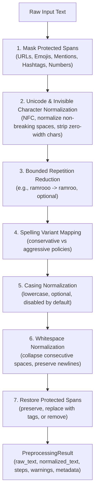

# Preprocessing Pipeline Gallery & Flow Architecture

This document illustrates the composable preprocessing flow, protected-span handling, and before/after normalization samples.

## Preprocessing Flow Diagram



---

## Before & After Sample Gallery

The following gallery shows real transformations executed by `PreprocessingPipeline` using the frozen default conservative configuration:

### 1. Spelling Elongation & Vowel Variation
- **Raw Text**: `yo geet sunera raamro lagyo, dheraiii maza aayo`
- **Normalized**: `yo geet sunera ramro lagyo, dherai maza aayo`
- **Steps Applied**: `['protect_special_tokens', 'normalize_variants_conservative', 'restore_special_tokens']`
- **Metadata**: `applied_variants: [{'from': 'raamro', 'to': 'ramro'}, {'from': 'dheraiii', 'to': 'dherai'}]`

### 2. Aspirated Copula & Chat Phonetics
- **Raw Text**: `kasto chha khabar sathi? ma ta thik chhu.`
- **Normalized**: `kasto cha khabar sathi? ma ta thik chu.`
- **Steps Applied**: `['protect_special_tokens', 'normalize_variants_conservative', 'restore_special_tokens']`
- **Metadata**: `applied_variants: [{'from': 'chha', 'to': 'cha'}, {'from': 'chhu', 'to': 'chu'}]`

### 3. Protected Spans (URLs, Mentions, Emojis Untouched)
- **Raw Text**: `Visit  https://hamro.com/news,  @anil_k  raamro  cha  🔥🔥`
- **Normalized**: `Visit https://hamro.com/news, @anil_k ramro cha 🔥🔥`
- **Protected Spans**:
  - `URL`: `https://hamro.com/news`
  - `MENTION`: `@anil_k`
  - `EMOJI`: `🔥` (x2)
- **Preservation Check**: No URL characters or emoji bytes were modified or corrupted during normalization.

### 4. Irregular Unicode & Invisible Glyphs
- **Raw Text**: `ramro\u00a0cha\u200bhai` (non-breaking space + zero-width space)
- **Normalized**: `ramro cha hai`
- **Steps Applied**: `['unicode_nfc', 'normalize_irregular_spaces', 'strip_zero_width']`
- **Warnings**: None; zero-width space stripped cleanly.

### 5. Multi-line Text with Preserved Line Boundaries
- **Raw Text**:
  ```text
  pahilo line   dheraiii   ramro.
  
  dosro line     vako     kura.
  ```
- **Normalized**:
  ```text
  pahilo line dherai ramro.
  
  dosro line bhayeko kura.
  ```
- **Line Structure**: Intact; horizontal whitespace collapsed without flattening newlines.
