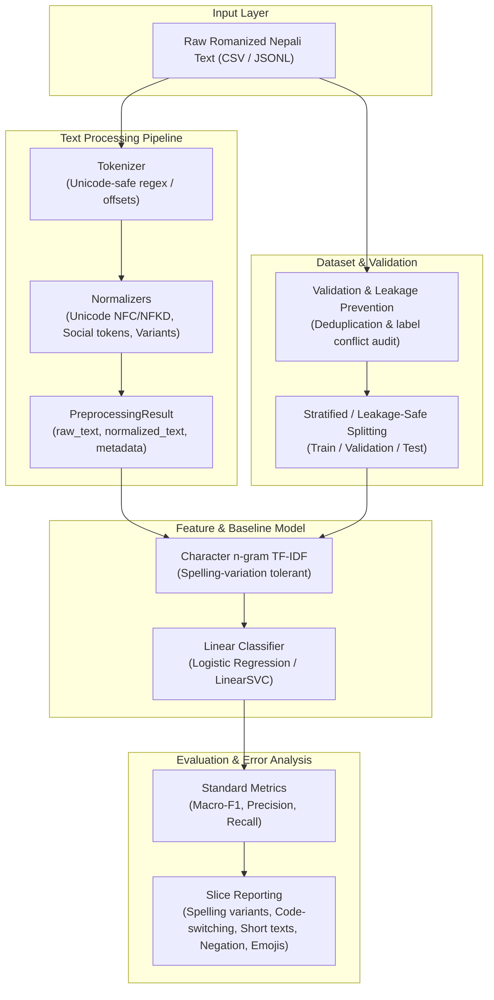

# Project Map: Romanized Nepali NLP Toolkit

This document maps the architectural flow from raw Romanized Nepali text to evaluated sentiment predictions.

## Component Overview

1. **Tokenizer (`tokenizer.py`)**: Preserves character offsets in code points and extracts categories (WORD, EMOJI, URL, MENTION, etc.).
2. **Normalization (`normalization.py` & `variants.py`)**: Non-destructive transformations. Always preserves `raw_text` and logs applied steps.
3. **Dataset & Validation (`dataset.py`, `quality.py`, `splitting.py`)**: Validates schemas, detects duplicate/contradictory labels across train/test splits.
4. **Features & Model (`features.py`, `sentiment.py`)**: Character n-grams tolerate orthographic variation (`ramro` / `raamro` / `ramroo`).
5. **Evaluation (`sentiment.py`)**: Produces per-slice performance breakdowns to evaluate robustness on noisy text.
