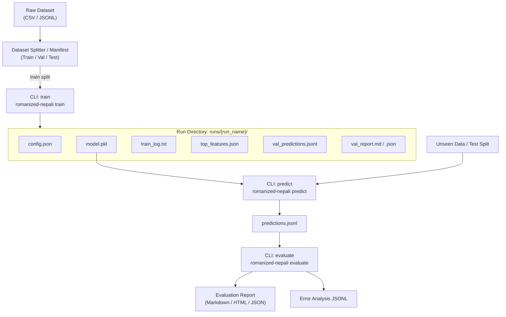

# Sentiment CLI Workflow & Run Architecture

Task 20: Comprehensive CLI specification and run lifecycle for Romanized Nepali sentiment baselines.

---

## 1. End-to-End Run Flow Diagram



---

## 2. Run Directory Convention

Every training run produces an isolated, self-contained run directory:

```text
runs/latest/
├── config.json            # Exact model config, data paths, sample counts, class list
├── model.pkl              # Serialized SentimentModel (vectorizer + classifier weights)
├── top_features.json      # Top predictive n-grams per class (sanitized)
├── train_log.txt          # Run execution transcript and metrics
├── val_predictions.jsonl  # Record-level validation predictions with confidence scores
├── val_report.json        # Machine-readable validation metrics and slice results
├── val_report.md          # Human-readable Markdown report with Mermaid charts
└── val_report.html        # Interactive browser-ready HTML report
```

---

## 3. End-to-End Terminal Transcript

### 3.1 Training a Character TF-IDF Baseline
```bash
$ romanized-nepali train tests/fixtures/romanized_examples.jsonl \
    --label-col expected_label \
    --model-type char \
    --analyzer char_wb \
    --min-n 2 --max-n 5 \
    --output-dir runs/char_mvp

Training char baseline on 75 records (seed=42, preprocess=True)...
Validation results: Accuracy=0.5625, Macro-F1=0.5000
✓ Run artifacts successfully written to: /Users/purushottamghimire/romanized-nepali-nlp/runs/char_mvp
```

### 3.2 Predicting Labels on Unseen Data
```bash
$ romanized-nepali predict tests/fixtures/valid_dataset.jsonl \
    --model runs/char_mvp \
    --format table

ID              Predicted    Conf     Text
------------------------------------------------------------
rec1            positive     0.57     ramro chha yo geet
rec2            positive     0.57     ramro chha yo geet
rec3            negative     0.43     dherai naramro film
rec4            negative     0.43     Dherai naramro film
rec5            positive     0.41     thik thikai ho
rec7            positive     0.56     yo ta sarhai ramro
rec8            negative     0.42     kasto hawa manche
rec9            neutral      0.48     aaja ma ghar janchhu
rec10           neutral      0.46     bholi bhetumla sathi
```

### 3.3 Evaluating Saved Predictions
```bash
$ romanized-nepali evaluate runs/char_mvp/val_predictions.jsonl \
    --dataset tests/fixtures/romanized_examples.jsonl \
    --format markdown \
    --export-errors runs/char_mvp/errors.jsonl

# Model Evaluation & Challenge Slice Report

## 1. Summary Performance
- Total Evaluated Records: 16
- Accuracy: 0.5625 (95% CI: [0.3125, 0.8125])
- Macro-F1: 0.5000 (95% CI: [0.2667, 0.7714])
- Weighted-F1: 0.5417
...
Exported 7 misclassified errors to runs/char_mvp/errors.jsonl
```

---

## 4. Actionable Diagnostics on Failed Runs

The CLI intercepts failure modes and reports actionable remedies:
- **No labeled data**: `Error: No valid labeled records provided for training.` -> Fix label column mapping or filter missing labels.
- **Model not found**: `Error: Model artifact not found: runs/foo/model.pkl` -> Verify run path or train model first.
- **Manifest mismatch**: `Error: Manifest file not found` -> Ensure `split` command generated manifest.
