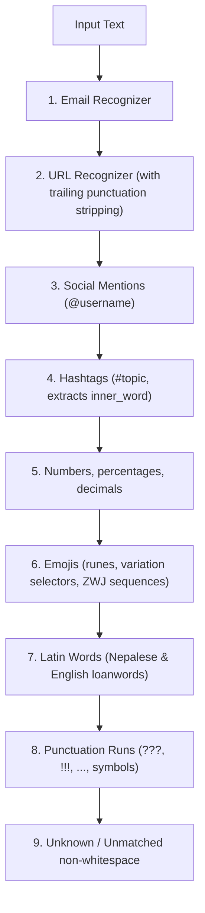

# Tokenization Specification & Architecture

This document details the Romanized Nepali tokenization strategy, character policies, and precedence ordering.

## Character Policy & Unicode Handling

1. **Latin Alphabet & Diacritics**:
   - Standard ASCII letters `[a-zA-Z]`.
   - Latin Extended characters `[\u00C0-\u024F]` and combining marks `[\u0300-\u036F]`.
   - Directly supports transliterated Romanized vowels and retroflex consonants (`nepālī`, `mānchhe`, `kṛpā`, `śānti`).
2. **Spelling Prolongations**:
   - Repeated characters (e.g. `ramrooo`, `dheraiii`, `chaaa`) are preserved within a single `WORD` token.
3. **Hyphens & Apostrophes**:
   - Intra-word hyphens (`day-to-day`, `bich-bichma`) and apostrophes (`don't`) are treated as internal word characters by default.
   - Configurable via `allow_hyphens=False` and `allow_apostrophes=False` in [`Tokenizer`](file:///Users/purushottamghimire/romanized-nepali-nlp/src/romanized_nepali_nlp/tokenizer.py#L76).
4. **Code-Point Offsets**:
   - `start` and `end` indices follow Python Unicode code-point positions, ensuring `text[token.start:token.end] == token.text`.

---

## Tokenizer Precedence Ordering

To prevent lossy or corrupt tokenization, patterns are evaluated in the following precedence order:

---

## Social & Special Token Rules

- **URLs**: Matches `https?://...` or `www....`. If followed immediately by trailing punctuation (e.g. commas or periods), the punctuation is separated so sentence structure is preserved:
  `"Visit https://hamro.com/news, today!"`
  $\rightarrow$ `[https://hamro.com/news|URL]`, `[,|PUNCTUATION]`, `[today|WORD]`, `[!|PUNCTUATION]`
- **Hashtags**: `#[a-zA-Z0-9_]+`. Stores the stripped label in `token.metadata["inner_word"]`.
- **Emojis**: Robust to compound emojis and presentation selectors (`U+FE0F`).
- **Code-Switching**: English words are categorized as `ENGLISH_WORD` when present in common loanword lexicons, or grouped under `WORD` if language classification is turned off (`classify_english=False`).
