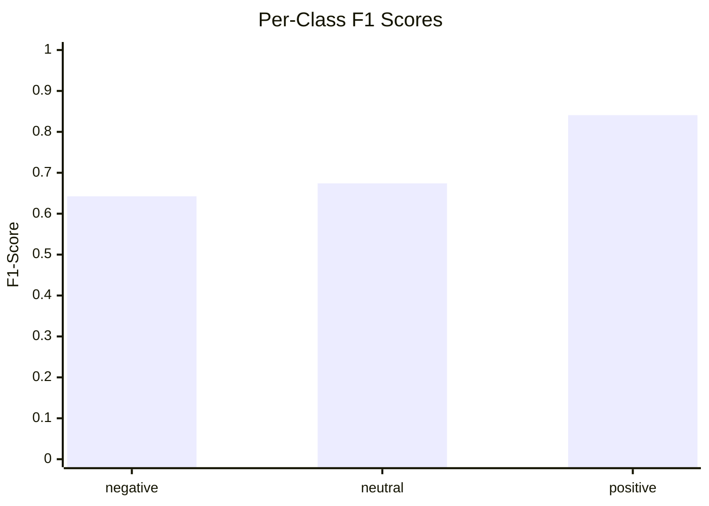
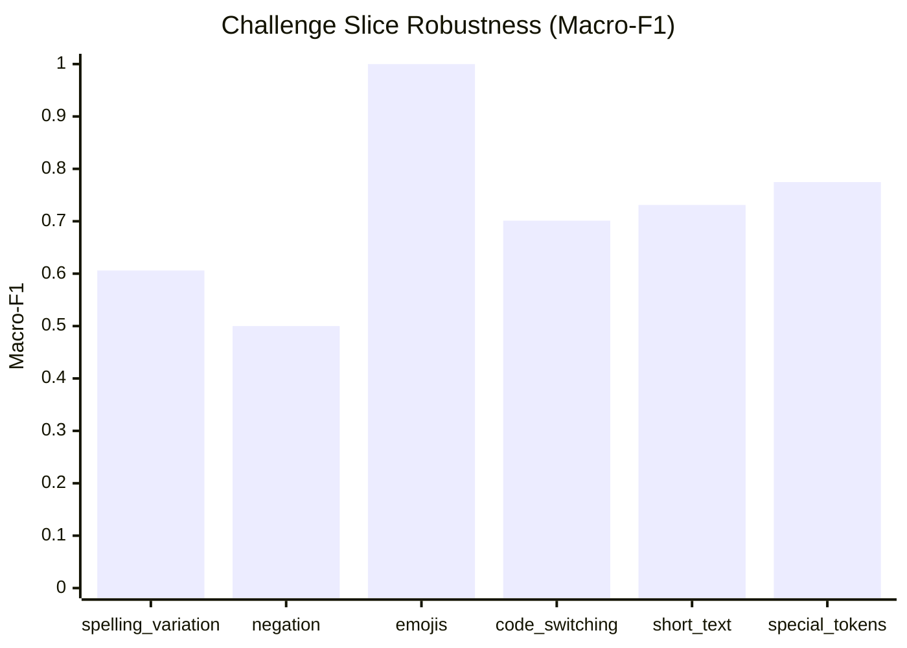

# Model Evaluation & Challenge Slice Report

## 1. Summary Performance

- **Total Evaluated Records**: 1495
- **Accuracy**: **0.7505** (95% CI: [0.7274, 0.7732])
- **Macro-F1**: **0.7191** (95% CI: [0.6948, 0.7430])
- **Weighted-F1**: **0.7546**

## 2. Per-Class Breakdown

| Class | Precision | Recall | F1-Score | Support |
|---|---|---|---|---|
| `negative` | 0.5862 | 0.7106 | **0.6424** | 311 |
| `neutral` | 0.6784 | 0.6700 | **0.6742** | 403 |
| `positive` | 0.8764 | 0.8079 | **0.8408** | 781 |

## 3. Confusion Matrix

| Gold \ Predicted | `negative` | `neutral` | `positive` |
|---|---|---|---|
| **`negative`** | 221 | 52 | 38 |
| **`neutral`** | 82 | 270 | 51 |
| **`positive`** | 74 | 76 | 631 |

## 4. Challenge Slice Robustness

| Slice | Count | Accuracy | Macro-F1 | Status |
|---|---|---|---|---|
| **spelling_variation** | 37 | 0.7027 | **0.6061** | ✅ Evaluated |
| **negation** | 41 | 0.6829 | **0.5000** | ✅ Evaluated |
| **emojis** | 6 | 1.0000 | **1.0000** | ✅ Evaluated |
| **code_switching** | 300 | 0.8200 | **0.7012** | ✅ Evaluated |
| **short_text** | 116 | 0.8362 | **0.7311** | ✅ Evaluated |
| **special_tokens** | 151 | 0.7815 | **0.7748** | ✅ Evaluated |

## 5. Visualizations

### Per-Class F1 Performance

### Slice Macro-F1 Comparison

## 6. Error Analysis Sample

Total misclassified instances: **373**

| ID | Gold | Predicted | Conf | Slices | Text |
|---|---|---|---|---|---|
| `nfr-0171815` | `positive` | `neutral` | 0.41 | none | Nawaj Ansari ON fire after coming in Nepal |
| `nfr-0076227` | `positive` | `negative` | 0.54 | none | Karma vai le atti diyotw aaja tw astinai ko v |
| `nfr-0030235` | `positive` | `negative` | 0.63 | none | dil ko Chhu Lene wali Kahani Hai. Doston Ham  |
| `nfr-0085917` | `positive` | `neutral` | 0.43 | none | All the boys look like k-drama main lead... A |
| `nfr-0057698` | `positive` | `neutral` | 0.39 | none | Like many Indians... I like Nepal and Russia  |
| `nfr-0063366` | `positive` | `neutral` | 0.36 | none | Hello man,.wow you're in nepal.i'm praying to |
| `nfr-0042617` | `positive` | `negative` | 0.41 | none | Prakash dutraj dai rw Melina Rai ley nikaleko |
| `nfr-0155250` | `positive` | `negative` | 0.45 | none | Mahabir pun vneko yo des ko prabidi ko king h |
| `nfr-0115364` | `positive` | `neutral` | 0.59 | none | Da ak bit. Ak.bit. Ak din sun nu hunxa. Mero  |
| `nfr-0063514` | `positive` | `neutral` | 0.50 | none | Khola gang myachiss . Day by day yo dai ko so |
| `nfr-0173983` | `positive` | `neutral` | 0.57 | none | Album ni chaiyo xitoo Yota matra intro ho |
| `nfr-0020916` | `positive` | `negative` | 0.56 | none | yarr sach me handsome hote hai yarr muzhe lag |
| `nfr-0026898` | `positive` | `negative` | 0.80 | code_switching, special_tokens | Deshko change ko lagi yetiko content banayera |
| `nfr-0058993` | `positive` | `neutral` | 0.49 | negation | Raju dai lok gitko ta raja ho Tara kaiile nad |
| `nfr-0125969` | `positive` | `neutral` | 0.47 | none | maile ne star maker bata thaha payar here KO  |
| `nfr-0251296` | `positive` | `neutral` | 0.53 | none | Bro is also rocking in rap |
| `nfr-0148135` | `positive` | `negative` | 0.42 | none | Punm ko voes ramro k grnu vot dine hru le mis |
| `nfr-0273067` | `positive` | `neutral` | 0.35 | none | la aba majja auni bhayo |
| `nfr-0067323` | `positive` | `neutral` | 0.40 | none | Jakie cudowne widoki poruszające wyobraźnię.. |
| `nfr-0286593` | `positive` | `neutral` | 0.39 | short_text | K saro hasako ho yll |