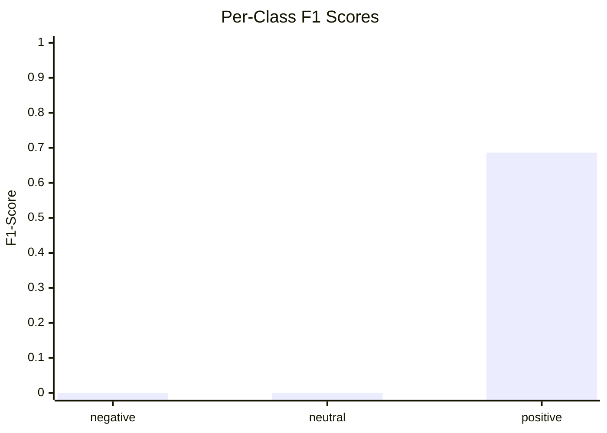
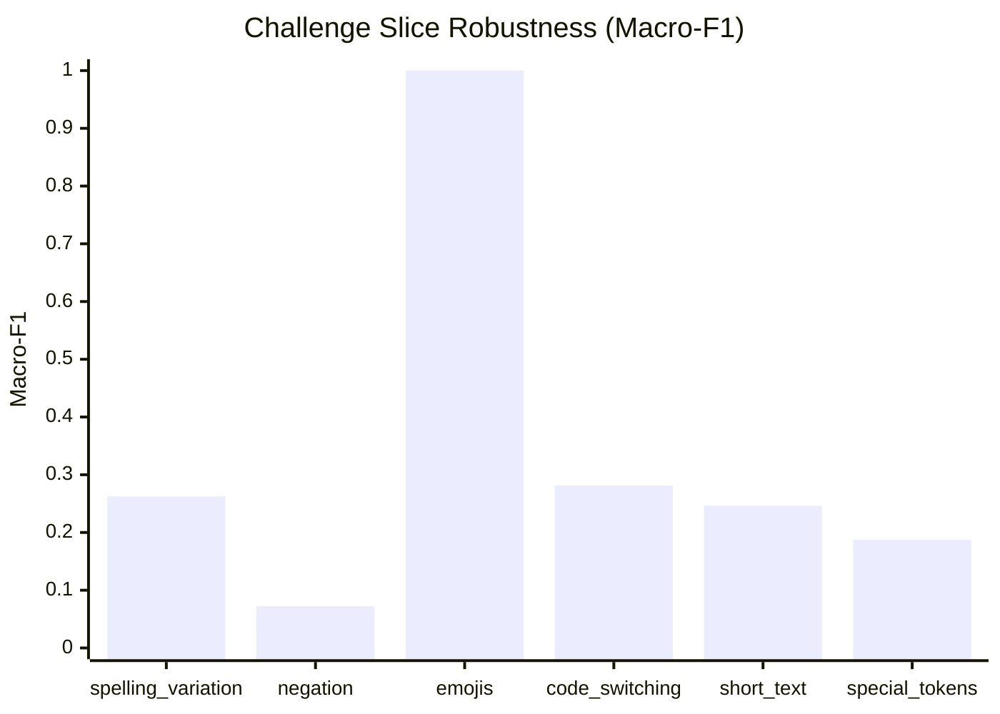

# Model Evaluation & Challenge Slice Report

## 1. Summary Performance

- **Total Evaluated Records**: 1495
- **Accuracy**: **0.5224** (95% CI: [0.4980, 0.5445])
- **Macro-F1**: **0.2288** (95% CI: [0.2216, 0.2350])
- **Weighted-F1**: **0.3585**

## 2. Per-Class Breakdown

| Class | Precision | Recall | F1-Score | Support |
|---|---|---|---|---|
| `negative` | 0.0000 | 0.0000 | **0.0000** | 311 |
| `neutral` | 0.0000 | 0.0000 | **0.0000** | 403 |
| `positive` | 0.5224 | 1.0000 | **0.6863** | 781 |

## 3. Confusion Matrix

| Gold \ Predicted | `negative` | `neutral` | `positive` |
|---|---|---|---|
| **`negative`** | 0 | 0 | 311 |
| **`neutral`** | 0 | 0 | 403 |
| **`positive`** | 0 | 0 | 781 |

## 4. Challenge Slice Robustness

| Slice | Count | Accuracy | Macro-F1 | Status |
|---|---|---|---|---|
| **spelling_variation** | 37 | 0.6486 | **0.2623** | ✅ Evaluated |
| **negation** | 41 | 0.1220 | **0.0725** | ✅ Evaluated |
| **emojis** | 6 | 1.0000 | **1.0000** | ✅ Evaluated |
| **code_switching** | 300 | 0.7300 | **0.2813** | ✅ Evaluated |
| **short_text** | 116 | 0.5862 | **0.2464** | ✅ Evaluated |
| **special_tokens** | 151 | 0.3907 | **0.1873** | ✅ Evaluated |

## 5. Visualizations

### Per-Class F1 Performance

### Slice Macro-F1 Comparison

## 6. Error Analysis Sample

Total misclassified instances: **714**

| ID | Gold | Predicted | Conf | Slices | Text |
|---|---|---|---|---|---|
| `nfr-0284476` | `negative` | `positive` | 0.52 | short_text, special_tokens | 250 bro u got robbed |
| `nfr-0076875` | `negative` | `positive` | 0.52 | none | Yo bhanda comedy darbar ramro hunthyo banda b |
| `nfr-0081180` | `negative` | `positive` | 0.52 | none | Lil Jhola is a trend not an artist, after som |
| `nfr-0143490` | `negative` | `positive` | 0.52 | none | He is a nepali Not an abrahamic bastard Jai n |
| `nfr-0099882` | `negative` | `positive` | 0.52 | none | copied from ful ma bhamara ; kamse kam credit |
| `nfr-0250889` | `negative` | `positive` | 0.52 | none | BDO ki liaj karna nahi ata |
| `nfr-0275436` | `negative` | `positive` | 0.52 | none | India ke log kb jagege |
| `nfr-0174019` | `negative` | `positive` | 0.52 | none | Ani mcc Mero ladoo pani kaloo xa jhola mc |
| `nfr-0036910` | `negative` | `positive` | 0.52 | special_tokens | West Nepal hoen my friend after narayan ghat  |
| `nfr-0165258` | `negative` | `positive` | 0.52 | special_tokens | 1:27 Copy of Hindi version of "Galat Karam" |
| `nfr-0029167` | `negative` | `positive` | 0.52 | none | Ma vko vye kasam tei glass le marne gari hand |
| `nfr-0093840` | `negative` | `positive` | 0.52 | none | Being brahmin i feel hurt that u forgot us Fr |
| `nfr-0032207` | `negative` | `positive` | 0.52 | none | Bhadragol sireal chai babbal commedy ho. aark |
| `nfr-0058118` | `negative` | `positive` | 0.52 | none | Yo prashna ko jawaf Rajendra Baniya le dinu p |
| `nfr-0143267` | `negative` | `positive` | 0.52 | none | English Bolna aaudai na bhane kina bolni hola |
| `nfr-0140166` | `negative` | `positive` | 0.52 | none | Inn north indians ko sirf muttur panneer hi k |
| `nfr-0017186` | `negative` | `positive` | 0.52 | code_switching | Alish bro ma tapaiko thulo fan hai tara yespa |
| `nfr-0279073` | `negative` | `positive` | 0.52 | none | 250me kon deta h bhai |
| `nfr-0278143` | `negative` | `positive` | 0.52 | none | Yesko career gayo Aaba |
| `nfr-0041219` | `negative` | `positive` | 0.52 | none | Roast ra Podcast ko meaning nabujhne haru aja |