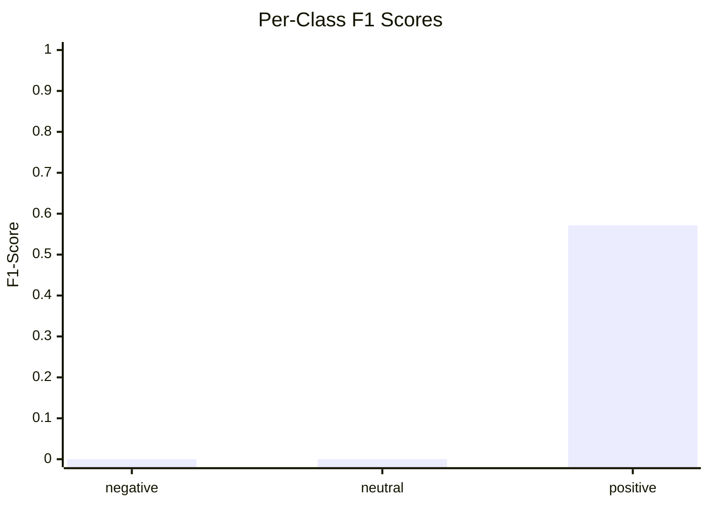
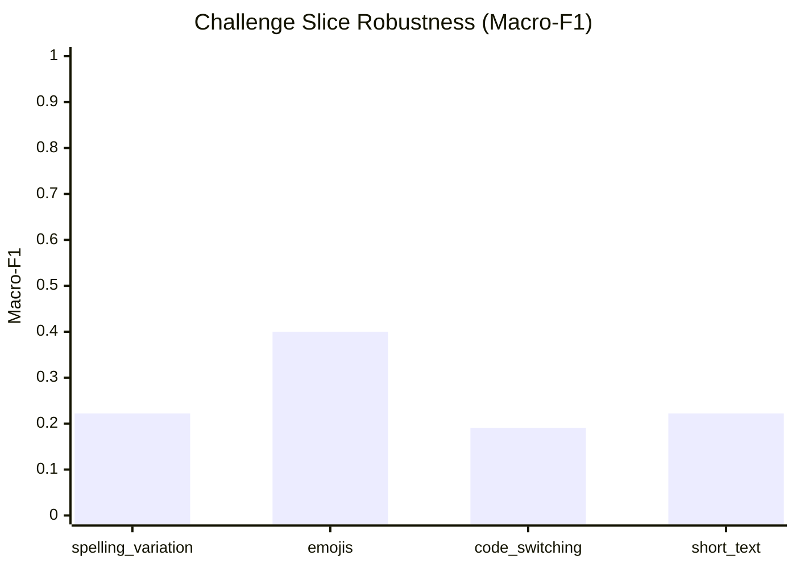

# Model Evaluation & Challenge Slice Report

## 1. Summary Performance

- **Total Evaluated Records**: 15
- **Accuracy**: **0.4000** (95% CI: [0.1333, 0.6667])
- **Macro-F1**: **0.1905** (95% CI: [0.0784, 0.2667])
- **Weighted-F1**: **0.2286**

## 2. Per-Class Breakdown

| Class | Precision | Recall | F1-Score | Support |
|---|---|---|---|---|
| `negative` | 0.0000 | 0.0000 | **0.0000** | 4 |
| `neutral` | 0.0000 | 0.0000 | **0.0000** | 5 |
| `positive` | 0.4000 | 1.0000 | **0.5714** | 6 |

## 3. Confusion Matrix

| Gold \ Predicted | `negative` | `neutral` | `positive` |
|---|---|---|---|
| **`negative`** | 0 | 0 | 4 |
| **`neutral`** | 0 | 0 | 5 |
| **`positive`** | 0 | 0 | 6 |

## 4. Challenge Slice Robustness

| Slice | Count | Accuracy | Macro-F1 | Status |
|---|---|---|---|---|
| **spelling_variation** | 4 | 0.5000 | **0.2222** | ✅ Evaluated |
| **negation** | 1 | N/A | **N/A** | insufficient_samples (n=1 < 3) |
| **emojis** | 3 | 0.6667 | **0.4000** | ✅ Evaluated |
| **code_switching** | 5 | 0.4000 | **0.1905** | ✅ Evaluated |
| **short_text** | 4 | 0.5000 | **0.2222** | ✅ Evaluated |
| **special_tokens** | 2 | N/A | **N/A** | insufficient_samples (n=2 < 3) |

## 5. Visualizations

### Per-Class F1 Performance

### Slice Macro-F1 Comparison

## 6. Error Analysis Sample

Total misclassified instances: **9**

| ID | Gold | Predicted | Conf | Slices | Text |
|---|---|---|---|---|---|
| `var_015` | `neutral` | `positive` | 0.37 | spelling_variation, short_text | k gardai xau sathi |
| `cs_002` | `neutral` | `positive` | 0.37 | code_switching | please malai support garnus na. |
| `cs_006` | `neutral` | `positive` | 0.37 | code_switching, special_tokens | mero <PHONE> ma call garna saknu huncha. |
| `ord_003` | `neutral` | `positive` | 0.37 | none | bhat khanu bhayo ta aaja? |
| `ord_017` | `neutral` | `positive` | 0.37 | none | kehi bujhina feri bhandinus na. |
| `var_016` | `negative` | `positive` | 0.37 | spelling_variation | mero phn ma chaldaina |
| `cs_007` | `negative` | `positive` | 0.37 | code_switching, special_tokens | delivery charge Rs 150 dherai mahango bhayo. |
| `neg_010` | `negative` | `positive` | 0.37 | negation | sarai jhur kura garyau yar. |
| `punc_017` | `negative` | `positive` | 0.37 | emojis, short_text | bore lagyo 🥱😴 |